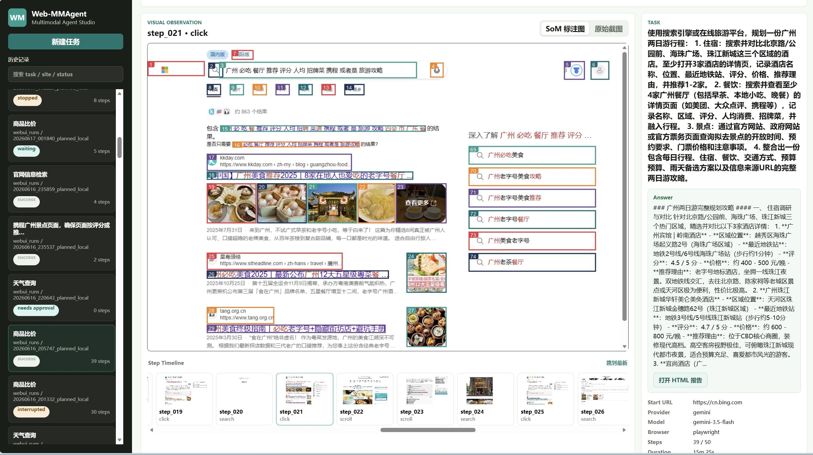
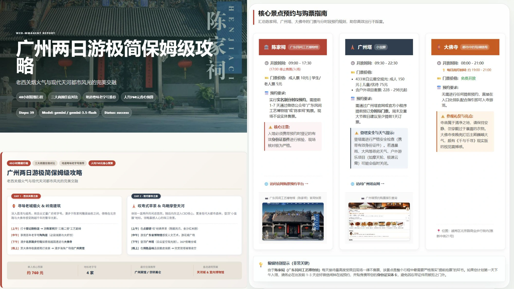
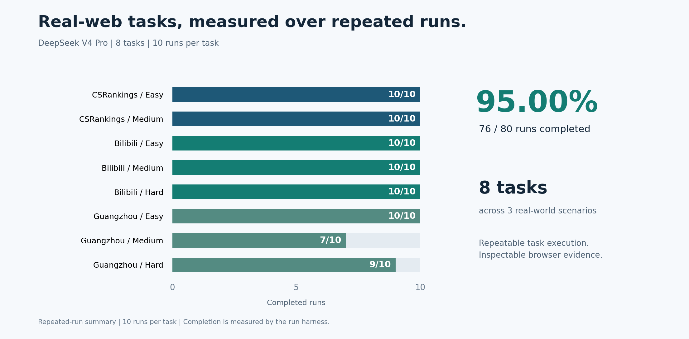
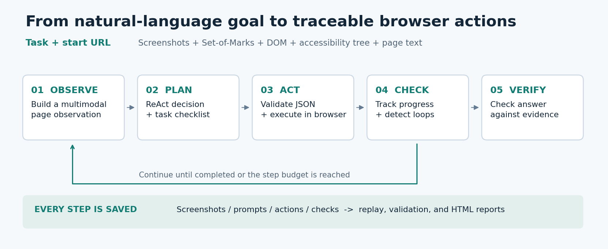

<div align="center">

# Web-VLMAgent

### See the page. Take action. Keep the evidence.

A multimodal web agent for real-browser research, multi-page planning, and report generation.

**3 scenarios** &nbsp; / &nbsp; **8 evaluated tasks** &nbsp; / &nbsp; **80 repeated runs** &nbsp; / &nbsp; **10-model study**

[Showcase](#showcase) · [Results](#evaluation-results) · [Architecture](#how-it-works) · [Quick Start](#quick-start) · [Run Guide](docs/USAGE.md)

Collaborative project with **Shengwei Wang** and **Lechao Wu**.

</div>

## Showcase

**From a natural-language request to browser actions and a visual report.** Web-VLMAgent reads screenshots and page structure, grounds actions in numbered elements, collects information across pages, and turns its findings into a browsable HTML report.



*An actual workbench capture from the project presentation: numbered element grounding, task context, and the step-by-step browser timeline in one view.*



*The complete travel-report showcase, captured directly from the presentation PDF: the two-day itinerary and attraction/booking guide are shown together in their original layout.*

*These are original presentation screenshots, not interface mockups. They retain the source-language website content and the earlier Web-MMAgent branding. Report appearance illustrates the output format; factual accuracy requires checking the underlying sources.*

## Evaluation Results

| Experiment | Outcome | Evaluation scope |
|---|---|---|
| **Repeated-run baseline: DeepSeek V4 Pro** | **76/80 completed (95.00%)** | 8 tasks, 10 runs per task; harness-reported completion |
| **Vision baseline: GPT-5.5** | **8/8 completed**; 9.75 steps on average | Same 8-task scope, one run per task; 2 CSRankings answers passed deterministic validation; 6 open tasks passed field-coverage checks |
| **Cross-model study** | **10 model configurations explored** | Vision and text observations; planning, grounding, and service-level failure analysis |



**From retrieval to multi-page planning.** The repeated-run baseline completed both CSRankings tasks and all three Bilibili tasks in 10/10 runs each. Guangzhou attraction comparison and two-day travel planning completed in 7/10 and 9/10 runs, respectively, showing where multi-page navigation and evidence collection still need improvement.

**Evaluation scope.** This summary uses eight tasks; CSRankings hard is outside this scope because its task specification was identified as problematic. Harness completion means the agent stopped with an answer. Deterministic validation is used for CSRankings; open-task field/source coverage still requires trace-based review. The GPT-5.5 baseline has one run per task.

Counts are drawn from the project report, Tables 10-12, and recomputed for this eight-task scope. No experiments were rerun for this README. [Protocol, complete task-level results, and limitations →](docs/EVALUATION.md)

## What This Project Builds

- **Multimodal grounding:** raw screenshots, Set-of-Marks annotations, DOM candidates, accessibility trees, and page text share one observation pipeline. Vision and text-only models use the same structured action interface.
- **Long-task orchestration:** task planning, checklists, progress checks, and a final verifier support multi-page information gathering and help detect loops or premature completion.
- **Inspectable execution:** every step preserves the observation, prompt, model response, parsed action, execution result, and verification artifacts for replay and error analysis.
- **An evaluation workbench:** YAML tasks, repeated runs, multi-model suites, deterministic validators, open-task coverage checks, and HTML reports connect implementation to measurable experiments.

### Real-Website Tasks

| Scenario | Easy | Medium | Hard |
|---|---|---|---|
| **CSRankings** | Find a top NLP professor | Build a scholar profile across sources | Compare university rankings across 8 AI/Systems areas and faculty coverage |
| **Bilibili** | Extract a public video's information | Compare the top 3 AI search results and their audiences | Browse candidate series, cross-check sources, and produce a recommendation page |
| **Guangzhou travel** | Retrieve the top listed attraction | Compare at least 3 Chimelong-related attractions | Research hotels, dining, attractions, transport, budget, and a rain-day alternative for a two-day trip |

These are project-defined tasks on live websites. The project implements an agent and evaluation framework; it does not train a new vision-language model.

## How It Works



1. **Observe:** capture the page and extract visible candidate elements with numbered marks.
2. **Plan:** combine the task, observation, and action history into a ReAct-style decision.
3. **Act:** validate the structured JSON action and execute it through the browser backend. Clicks and typing reference a current `target_id`.
4. **Check:** update task progress and detect stalled or repetitive behavior.
5. **Verify:** inspect completion evidence, preserve the trace, and generate an answer/report.

<details>
<summary><strong>Explore the implementation</strong></summary>

| Component | Source |
|---|---|
| Browser control and action validation | [`browser/`](browser/) |
| Set-of-Marks annotation | [`perception/`](perception/) |
| Agent, planning, checklists, and verification | [`agents/`](agents/) |
| Model adapters | [`models/`](models/) |
| Evaluation, metrics, and validators | [`eval/`](eval/) |
| Nine task definitions | [`tasks/`](tasks/) |
| Workbench and replay | [`webui/`](webui/) |

```text
step_000/
  screenshot.png              Raw browser observation
  marked_screenshot.png       Numbered visual grounding
  accessibility_tree.txt      Accessible page structure
  candidates.json             Actionable DOM elements
  prompt.txt                  Model input
  raw_response.txt            Model output
  parsed_action.json          Validated action
  execution_result.json       Browser feedback
  progress_check.json         Progress assessment
  final_verification.json     Completion evidence
```

</details>

## Quick Start

Requires **Python 3.10+** and an API key for your chosen provider. From PowerShell:

```powershell
git clone https://github.com/Wangych297/Web-VLMAgent.git
cd Web-VLMAgent
python -m venv .venv
.\.venv\Scripts\Activate.ps1
pip install -r requirements.txt
python -m playwright install chromium
Copy-Item .env.example .env
```

Set `OPENAI_API_KEY`, `OPENAI_BASE_URL`, and `OPENAI_MODEL` in `.env` for your OpenAI-compatible provider, or configure the corresponding DeepSeek/Gemini settings.

**Open the workbench:**

```powershell
python webui/server.py --host 127.0.0.1 --port 8601
```

Visit **<http://127.0.0.1:8601>** to start a task and inspect its execution.

**Run a task from the command line:**

```powershell
python scripts/run_task.py `
  --url "https://csrankings.org/#/fromyear/2020/toyear/2025/index?nlp&us" `
  --task "Find the professor with the most publications at the highest-ranked US university in NLP for 2020-2025." `
  --provider openai `
  --model gpt-4.1-mini `
  --observation_mode vision `
  --max_steps 12
```

Use a model supported by your configured provider. Live pages and model endpoints may differ from the recorded experiments.

[Environment configuration, batch evaluation, trace validation, and replay →](docs/USAGE.md)

## Scope and Limitations

Open-task field coverage is a preliminary check rather than a factual-accuracy guarantee. Live websites change; popups, navigation, API timeouts, and context limits affect reproducibility. The multi-model study uses different observation modes, so its results are exploratory rather than a controlled model ranking.

Browser execution validates actions and blocks high-risk operations including login, payment, purchases, deletion, and sensitive submissions. The model does not execute arbitrary generated code. See the [action-space and safety details](docs/USAGE.md#action-space).

## Team

Developed collaboratively for *Principles and Applications of Multimodal Large Models* at Sun Yat-sen University.

| Contributor | Main contributions documented in the project report |
|---|---|
| **[Wangych297](https://github.com/Wangych297)** | Engineering extensions; multimodal observations and browser backends; long-task runner, checklists, progress/final verification, WebUI and HTML reports; Guangzhou travel tasks; presentation materials and delivery |
| **Shengwei Wang** | Architecture and baseline; browser/action/trace and evaluation pipeline; CSRankings tasks; model experiments, error analysis, and report writing |
| **Lechao Wu** | Bilibili tasks; implementation and evaluation collaboration; result checking, analysis, and report writing |
